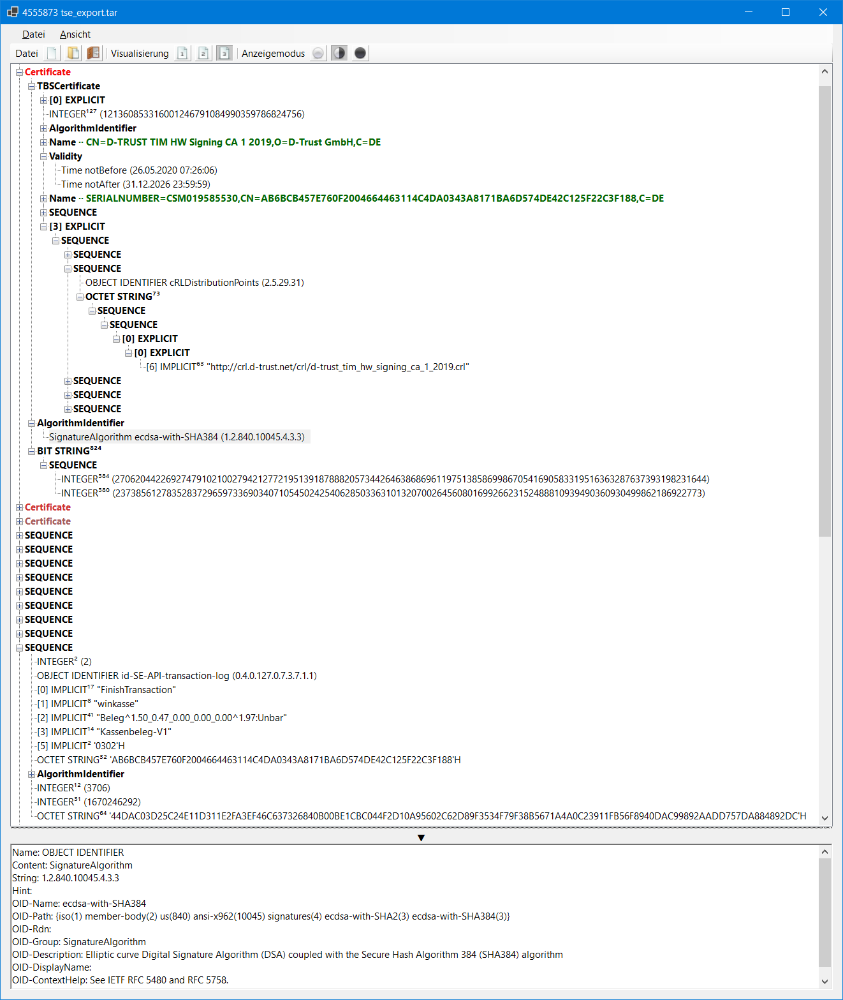
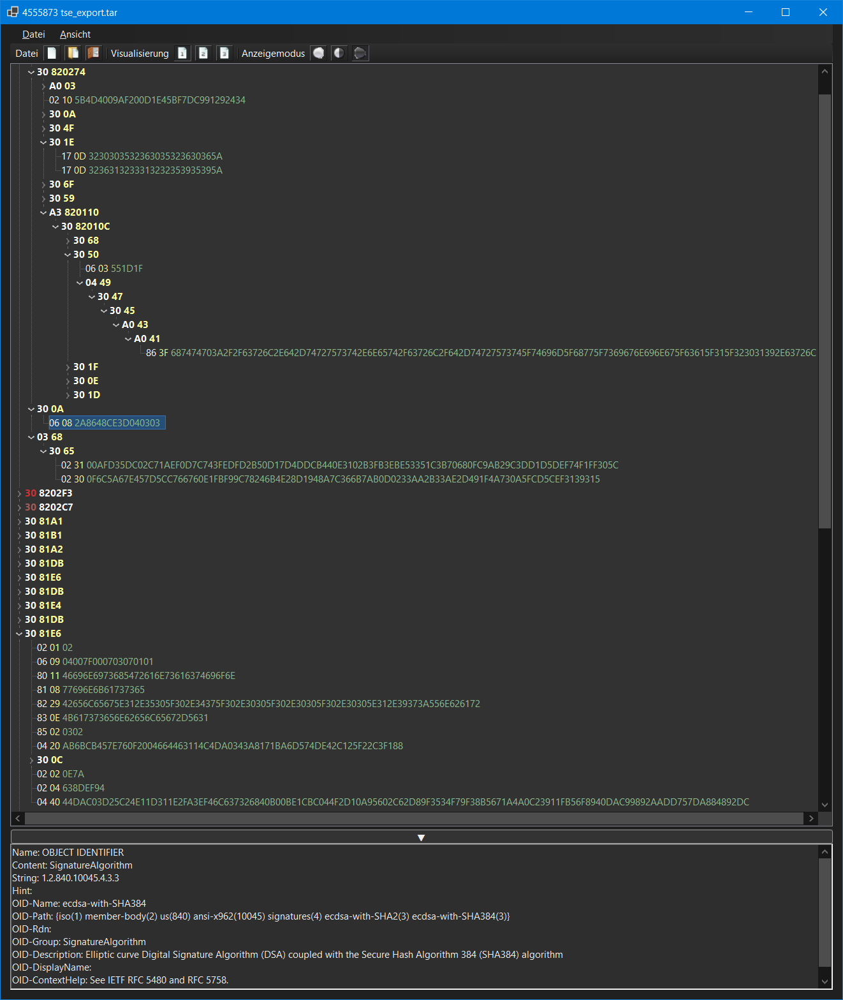
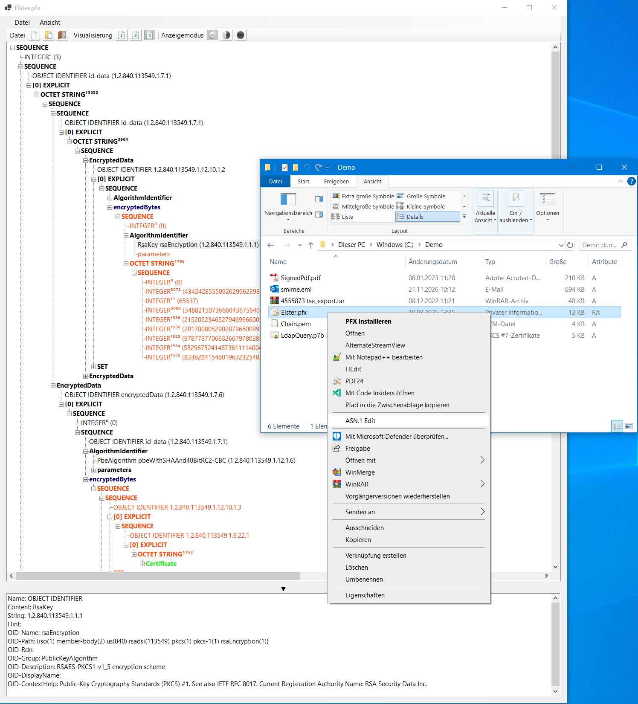

# ASN.1 Viewer

Ein selbsterklärender, strukturgenauer Decoder und Viewer für ASN.1-kodierte Sicherheitsstrukturen (X.509-Zertifikate, PKCS#12/PFX, CMS/PKCS#7, Sperrlisten, Zeitstempel, TSE-Exporte usw.).

> **Hinweis zur Bewerbung beim Prototype Fund (Jahrgang 03):**
> Dieser Prototyp befindet sich derzeit in aktiver Entwicklung. Das vollständige Quellcode-Repository wird daher noch privat gepflegt und im Falle einer Förderzusage unter einer Open-Source-Lizenz (MIT / Apache 2.0) hier veröffentlicht.

---

## Warum ASN.1 Viewer?

Kryptografische Nachweise – von der digitalen Signatur an einer Telekom-Rechnung über elektronische Steuerbelege (TSE) bis hin zu Code-Signaturen – basieren auf der Notationssprache **ASN.1**. Bestehende Tools zeigen jedoch oft nur unübersichtliche Hex-Werte oder flache technische Tag-Bäume, die tief aufgeklappt werden müssen, um überhaupt zu erkennen, worum es geht.

**Der ASN.1 Viewer macht komplexe PKI-Strukturen direkt lesbar:**
* **Mehrstufige Darstellung:** Umschaltbar zwischen *Technisch* (rohe TLV-Hex-Daten), *Syntaktisch* (ASN.1-Grundtypen und Werte) und *Semantisch* (konkrete Schema-Namen wie `Certificate`, `Validity`, `Name` kombiniert mit kontextbezogenen Kommentaren wie derzeit schon bei `-- CN=D-TRUST...`).
* **Kontextbewusste Analyse:** Durch Eltern-Kind-Rückreferenzen im Ansichtsbaum werden auch verschachtelte Unterstrukturen (etwa in `BIT STRING` oder `OCTET STRING`) erkannt und verständlich benannt und kommentiert.
* **Umfangreiche OID-Datenbank:** Direkte namentliche Auflösung von Object Identifiern mit Beschreibungen, OID-Pfaden, Verweisen und Links auf zugrundeliegende Standards (RFC, ISO, ETSI etc.).
* **Lokale Sicherheit:** Im Gegensatz zu Online-Tools verlassen sensible Daten, wie kryptografische Schlüssel, zur Einsichtnahme niemals den Rechner.
* **Nahtlose Windows-Integration:** Über eine Kontextmenü-Erweiterung (`ASN.1 View`) lassen sich Dateien sowie eingebettete Signaturen direkt aus dem Explorer heraus sowie per Drag & Drop auch aus dem Mailprogramm laden und untersuchen.

---

## Aktueller Entwicklungsstand (Prototyp)

### 1. Semantische Ansicht – erster Ausbaustand (Hellmodus)
Erste Strukturerkennungen (u. a. derzeit in Teilen für X.509-Zertifikate und TSE-Transaktionslogs), inline Kommentare (`--`) und ausführliche OID-Metadaten machen den Inhalt ohne mühsames Aufklappen verständlich:

### 2. Technische Rohansicht (Dunkelmodus)
Dieselbe Datei in der technischen TLV-Hex-Ansicht – genau diese rohe Byte-Ebene zeigen herkömmliche Werkzeuge, die für Nicht-Spezialisten kaum lesbar ist:

### 3. Windows-Kontextmenü & PKCS#12/PFX-Entschlüsselung
Über die Explorer-Integration (im Prototyp derzeit als „ASN.1 Edit“ im Kontextmenü) lassen sich Dateien direkt öffnen, inklusive der Entschlüsselung geschützter Container (nach optionaler Passwort-Abfrage) wie hier `Elster.pfx` bis in die RSA-Schlüsselparameter und Zertifikate hinein:

### Was bereits läuft:
- [x] Rekursiver ASN.1-Dekoder (C#) mit Eltern-Kind-Rückreferenzen und Unterstützung von indefiniten Längen sowie sehr großen Dateien
- [x] Technische Rohansicht (`Technical`) sowie erster Ausbaustand der semantischen Ansicht (`Semantic`)
- [x] Farblich differenzierte Baumansicht mit Hell-, System- und Dunkelmodus
- [x] Umfangreiche OID-Auflösung über eine erweiterbare JSON-Datenbank mit Anmerkungen und Links zu Normen-Standards im Detail-Panel
- [x] Windows-Kontextmenü-DLL (C++) für eigenständige ASN.1-Dateien, Container (PEM, TAR), Binärdateien und (noch experimentell) signierte E-Mails und PDFs

---

## Geplante Weiterentwicklung (Förderzeitraum)

Im Rahmen der Prototype-Fund-Förderung soll der Prototyp zu einem vollständigen Werkzeug ausgebaut werden:
- [ ] **Syntaktischer Modus (`Syntactic`):** Vollständige Formatierung aller 36 ASN.1 Universal Tags inklusive Längen- und Strukturinformationen
- [ ] **Ausbau des semantischen Modus (`Semantic`):** Umfassende Schema-Datenbank und automatische Inline-Kommentare (`-- ...`) für alle gängigen X.509-, PKCS-, CMS-, eIDAS- und TSE-Standards
- [ ] **Vertrauensstellung:** Visuelle Kenntlichmachung der Prüfung gefundener Zertifikatsketten
- [ ] **Synchronisierte Hex-/Byte-Ansicht:** Direktes Nachvollziehen von Offsets und Längen im Rohdatenstrom
- [ ] **Erweiterte Dokumenten- & Container-Analyse:** Vertiefte Auswertung komplexer PDF-Signaturen und verschachtelter E-Mail-Anhänge
- [ ] **Mehrsprachigkeit & Kontext-Hilfe:** Deutsche und englische Oberfläche sowie direkte Verweise auf Referenz-Standards
- [ ] **Plattform-Portabilität (Linux):** Nutzung des plattformunabhängigen .NET-Kerns als Basis für eine spätere Linux-Unterstützung

---

## Autor & Hintergrund

Entwickelt von **Peter-Michael Hager** – langjährige Erfahrung in der Entwicklung von ASN.1- und PKI-Software (u. a. GERVA für DATEV, nPA, ePass, Dyalog Cryptographic Library, Entwickler-Support für Technische Sicherheitseinrichtungen / TSE).
